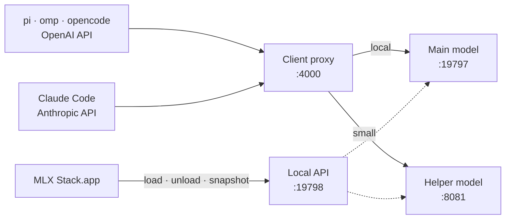

# MLX Stack

Native macOS menu-bar app that runs a local LLM on Apple Silicon through [MLX](https://github.com/ml-explore/mlx-lm) or [llama.cpp](https://github.com/ggml-org/llama.cpp) and hands it to coding agents over localhost. The Python backend is part of this repository and ships inside the app; nothing else needs to be installed.



All four services bind to `127.0.0.1` only. The local API and the client proxy also answer a request only when it addresses this machine by name and does not come from a web page, so a site open in a browser cannot load, stop or delete models through them. The two model servers take no key: any program run by your user can call them on their ports.

## Install

```console
brew tap mukhanov/local-llm
brew trust mukhanov/local-llm
brew install --cask mlx-stack
open -a "MLX Stack"
```

The cask puts `MLX Stack.app` in `/Applications`. The backend and `uv` travel inside the bundle; no Python installation or terminal setup is needed.

On first launch the app creates `~/.mlx-stack/mlx-stack-venv` and installs the backend's Python dependencies, which needs internet access once. An existing `~/.ollmlx` is migrated to `~/.mlx-stack` and kept as a compatibility symlink.

The backend needs three Python packages — `mlx-lm`, `huggingface-hub` and `psutil` — and otherwise only the standard library. GGUF models fetch a `llama-server` build on first use.

## Models

- Browse what is downloaded or search Hugging Face, by format (MLX or GGUF) and by author (mlx-community or everyone), sorted by fit score or by downloads. Each row shows size, downloads, likes and the hardware fit for this Mac: score, quality, speed, context and estimated tokens per second.
- MLX repositories are served by `mlx_lm.server`. GGUF repositories are served by llama.cpp's `llama-server`, which is downloaded on first use and pinned under `~/.mlx-stack/llama.cpp`.
- Downloads run in the background while the loaded models keep serving. They show percentage, bytes and speed, can be paused, resumed and cancelled, and resume after a restart.
- Deleted models are remembered and marked in the catalog; they come back only through an explicit download.
- **Load…** opens the launch parameters: context and prompt cache sized against a shared RAM budget, KV-cache quantization, sampling (temperature, top-p, top-k, min-p), max tokens and the load and client timeouts, with a live forecast of memory use once the cache is full. They are saved per model in `~/.mlx-stack/model-settings.json`; **Defaults** returns to the stack-wide values.
- Loading shows what is happening right away: the model's row and Monitor show a progress bar with the stage and the elapsed seconds. It fills as the weights come into memory (resident memory against their size on disk), then goes through *Starting helper model* and *Warming up*. A failed start is reported with its reason.
- Models can be loaded from the window or from the status-bar menu. A stack started from a terminal is shown in Monitor and Tools but never taken over.

## Monitor

Updated once a second for the main or the helper model, selected with the Main/Small switch.

- **Summary**: decode speed, requests since load and per minute, context used against its cap, memory and swap.
- **Generation**: decode tokens per second over the last four minutes as a line, above an activity band showing whether the model was generating, reading a prompt or waiting for the client, with a tick for every request arrival. A caption gives the same breakdown in words, for example `generating 41% · reading prompt 2% · waiting for client 57% · 32 requests in 4 min`.
- **Context usage**: context size on the same time axis, time to first token, uncached tokens and active requests.
- **System resources**: CPU history and per-core load, memory, swap, the stack's processes and the heaviest other processes.
- **Logs**: collapsed by default. Backend errors and launch failures appear at the top with a **Review logs** action.

Only harness traffic is counted; the watchdog and warm-up probes are excluded. A watchdog restarts a model server that exits or stops completing requests.

## Tools

- Connection settings for pi, omp, opencode and Claude Code: launch command, endpoint, model alias and the canonical config path, with *Show in Finder* and *Copy path*.
- The stack's own files: model defaults, global context limits, omp roles, the Hugging Face token and the logs folder.

⌘1, ⌘2 and ⌘3 switch between Models, Monitor and Tools. Closing the window keeps the app in the status bar; **Exit** in its menu stops the models and quits.

## Use with coding agents

Loading a model writes the harness configuration and points every harness at the client proxy on `127.0.0.1:4000`:

| Harness | Start | Configuration |
|---|---|---|
| pi | `pi --model ollmlx/local` | `~/.pi/agent/models.json` |
| omp | `omp --model ollmlx/local` | `~/.omp/agent/models.json` and `~/.omp/agent/config.yml` |
| opencode | `opencode --model ollmlx/local` | `~/.config/opencode/opencode.json` |
| Claude Code | `claude --settings ~/.mlx-stack/configs/claude.json` | `~/.mlx-stack/configs/claude.json` |

Each harness file is a symlink to its canonical copy in `~/.mlx-stack/configs`; a file that already exists is copied there first.

The proxy speaks both APIs:

| API | Endpoints | Used by |
|---|---|---|
| OpenAI | `POST /v1/chat/completions`, `GET /v1/models` | pi, omp, opencode |
| Anthropic | `POST /v1/messages` | Claude Code |

- Model names: `local` is the loaded main model, `small` the helper. Any other name is refused with `404`, because the model server would otherwise load whatever repository a request names.
- Anthropic requests are translated to chat completions, streaming and tool use included.
- Send the key from the harness configs as `Authorization: Bearer …` or `x-api-key`.
- The helper model (`mlx-community/Qwen3-0.6B-4bit` by default, override with `OLLMLX_SMALL_MODEL`) answers short background calls so they do not queue behind the main model.

## Backend without the app

The same backend runs headless from `Backend/local-llm`:

| Argument | |
|---|---|
| `serve <org/model> [quant]` | Start a model in the foreground; Ctrl-C or SIGTERM stops it |
| `list` | Downloaded models with size and RAM estimate |
| `stop` | Stop the model servers an interrupted run left on the stack's ports; model servers on other ports are left alone |
| `rm [org/repo…]` | Delete downloaded models; prompts when called without arguments |
| `token [hf_… \| --clear]` | Show, save or clear the Hugging Face token |
| `widget` | Open MLX Stack.app |

Ports and limits are set with environment variables. In the app, the launch parameters chosen in Models take precedence.

| Variable | Default | |
|---|---|---|
| `MLX_PORT` | `19797` | Main model server |
| `MLX_SMALL_PORT` | `8081` | Helper model server |
| `PROXY_PORT` | `4000` | Client proxy |
| `WIDGET_PORT` | `19798` | Local API of the app |
| `MLX_MAX_CTX` | `110000` | Hard context ceiling in tokens |
| `MLX_PROMPT_CACHE_BYTES` | `17179869184` | Prompt cache limit, `0` disables it |
| `MLX_KV_BITS`, `MLX_KV_GROUP_SIZE` | `0`, `64` | KV-cache quantization, `0` disables it |
| `LOAD_TIMEOUT`, `CLIENT_TIMEOUT` | `900`, `1800` | Seconds to wait for the weights; budget per request |
| `OLLMLX_TEMP`, `OLLMLX_TOP_P`, `OLLMLX_TOP_K`, `OLLMLX_MIN_P` | `0.0`, `1.0`, `0`, `0.0` | Sampling defaults of the model server |
| `OLLMLX_MAX_TOKENS` | `32768` | Longest answer, in tokens |
| `OLLMLX_SMALL_MODEL`, `OLLMLX_LLAMA_SERVER` | | Helper model; path to a `llama-server` binary |
| `MLX_STACK_HOME` | `~/.mlx-stack` | Settings, configuration and logs |

## Files

```
~/.mlx-stack/
├── mlx-stack-venv/         Python environment of the bundled backend
├── configs/                harness configuration, canonical copies
├── logs/                   app.log, mlx-stack.log, mlx-server.log, mlx-small.log,
│                           proxy.log, mlx-watchdog.log, llama-server.log
├── llama.cpp/              pinned llama-server build for GGUF models
├── model-settings.json     launch parameters per model
├── context-settings.json   stack-wide context and prompt-cache limits
├── launch.json             stage of the model being loaded, removed when it serves
├── downloads.json          unfinished downloads
├── deleted-models.json     models deleted locally
└── hf-token                Hugging Face token
```

Server and proxy logs keep the previous run as `.log.1`.

## Build from source

Requirements: macOS 14+, Apple Silicon, Swift Command Line Tools and [uv](https://docs.astral.sh/uv/). The build bundles `uv` into the app.

```console
./build.sh 0.1.5
open "build/MLX Stack.app"
```

The script compiles the Swift sources in `Sources/`, copies the backend from `Backend/`, signs the bundle and writes `releases/MLXStack-v0.1.5.zip`, the artifact the Homebrew cask installs.

## Tests

```console
swiftc Sources/MemoryBudget.swift Tests/MemoryBudgetTests.swift -o /tmp/mlx-memory-budget-tests
/tmp/mlx-memory-budget-tests
PYTHONPATH=Backend ~/.mlx-stack/mlx-stack-venv/bin/python -m unittest discover -s Backend/tests -v
```

## How it runs

At launch the app uses its bundled `uv` to prepare `~/.mlx-stack/mlx-stack-venv`, installs the backend from `Contents/Resources/backend` as a regular package and starts `python -m local_llm.widget`, the local API on port 19798. The backend is reinstalled whenever its files in the bundle change.

Loading a model starts `python -m local_llm serve <model>`, which runs the client proxy in its own thread and the model servers as foreground children. Quitting the app, or choosing **Exit** in the status-bar menu, stops them all.

## License

MIT
